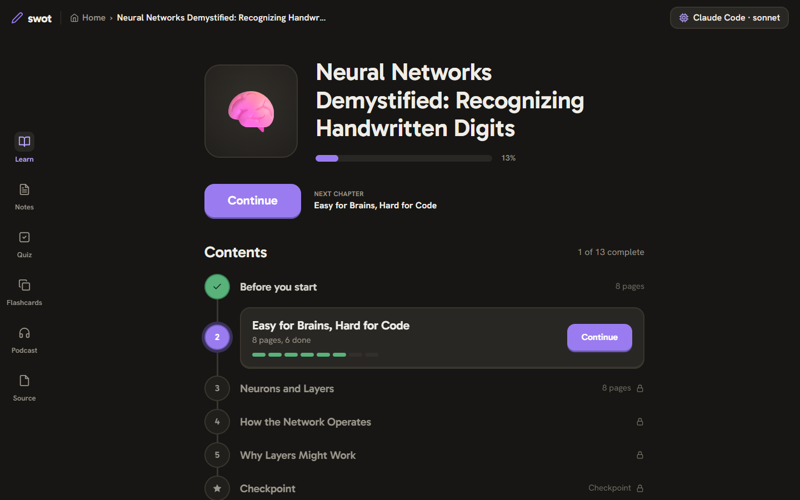
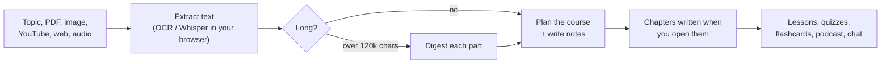
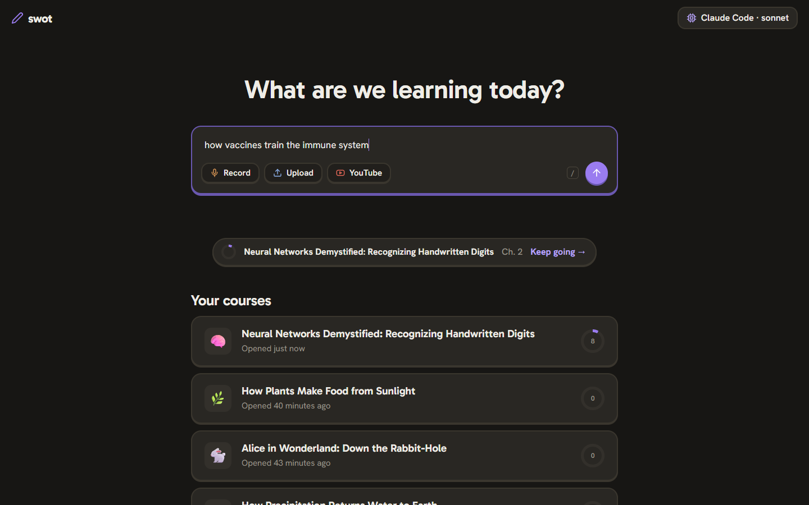
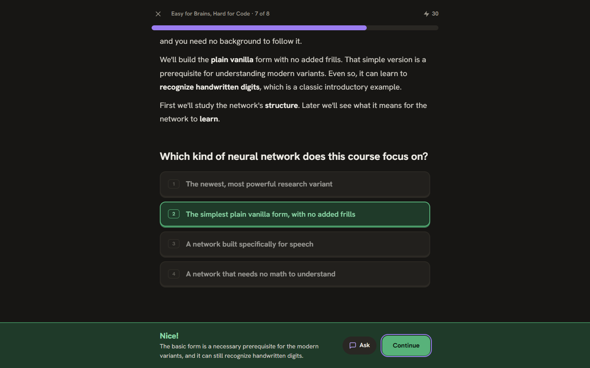
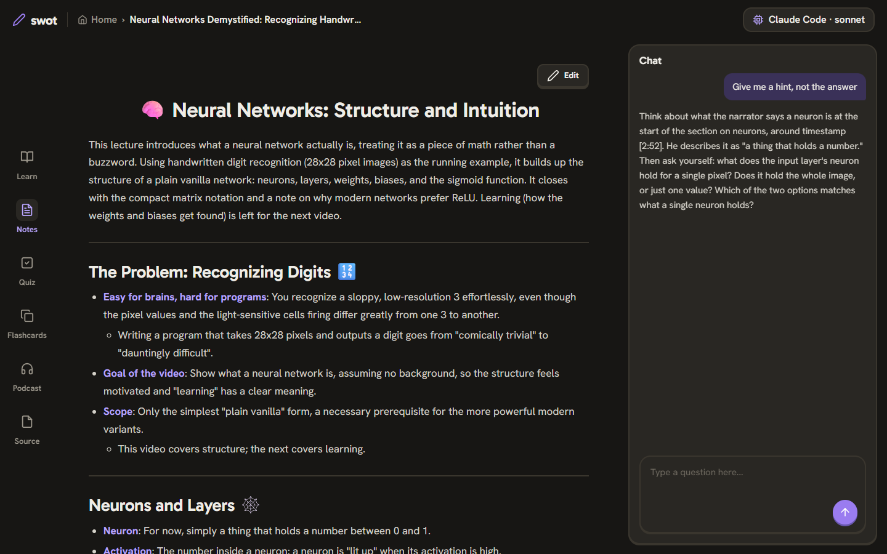
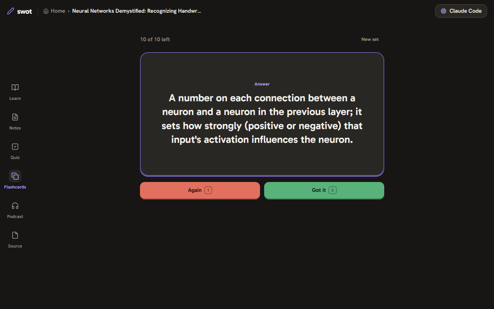

<p align="center">
  
</p>

<h1 align="center">Swot</h1>

<p align="center">
  <b>Learn anything as an interactive course.</b><br>
  Lessons, notes, quizzes, flashcards and a podcast from a topic, a PDF, a YouTube video, a website or a lecture recording,<br>
  powered by the <b>Claude Code</b> or <b>Codex</b> subscription you already have.
</p>

<p align="center">
  <a href="LICENSE"></a>
  
  
</p>

<p align="center">
  <b>Windows</b> (in PowerShell) &nbsp;<code>irm https://raw.githubusercontent.com/Samurai007AK/swot/main/install.ps1 | iex</code><br>
  <b>macOS / Linux</b> &nbsp;<code>curl -fsSL https://raw.githubusercontent.com/Samurai007AK/swot/main/install.sh | sh</code>
</p>

<p align="center">
  
</p>

---

## Why Swot

- **No API key, no bill.** Swot drives the `claude` or `codex` CLI you're already signed in to, so it runs on your subscription, with the model you pick.
- **Courses, not summaries.** Material becomes short chapters of reading pages and questions that unlock in order, with XP, checkpoints and a final quiz.
- **Private by default.** Everything runs on your computer. Scanned pages and recordings are read on your machine with open-source models.
- **Any source.** A topic, notes, PDFs (including scanned ones), photos of notes, YouTube, web articles, audio files or a live recording.

## Install

You need [Node.js](https://nodejs.org) 20 or newer, and [Claude Code](https://docs.claude.com/en/docs/claude-code) or [Codex](https://github.com/openai/codex) installed and signed in. Run `claude` or `codex` in a terminal once to sign in.

Then paste one line into a terminal.

**Windows**: open **PowerShell** (press Start, type *PowerShell*, press Enter) and paste:

```powershell
irm https://raw.githubusercontent.com/Samurai007AK/swot/main/install.ps1 | iex
```

In Command Prompt instead? Type `powershell`, press Enter, then paste the line above. You don't need to run as administrator.

**macOS / Linux**:

```bash
curl -fsSL https://raw.githubusercontent.com/Samurai007AK/swot/main/install.sh | sh
```

It downloads Swot into `~/.swot/app`, adds a `swot` command, and opens **http://127.0.0.1:4310**. Next time, just run:

```bash
swot
```

To choose which one does the AI work, and which model, click the chip in the top-right corner.

**Update:** run the install line again. Your courses are kept.

**Uninstall:** delete `~/.swot/app` and the `swot` command (`~/.local/bin/swot` on macOS and Linux, `%USERPROFILE%\.swot\bin` on Windows). Delete `~/.swot` to remove your courses too.

## Learn from anything

| You give it | Swot does |
| --- | --- |
| A topic: *"how vaccines train the immune system"* | Teaches it from general knowledge |
| Notes, pasted or as `.txt` / `.md` | Uses them as the source |
| A PDF | Reads the text layer, and runs **OCR on scanned pages** in your browser (English and Hindi) |
| A photo or screenshot of notes | Reads it with **OCR**: English, Hindi (Devanagari) and Hinglish |
| A YouTube link | Uses the video's transcript |
| A website link | Extracts the article and skips menus and ads. A link to a PDF is read as a PDF. |
| An audio file, or **Record** | Transcribes it on your computer with **Whisper**, with timestamps |
| A whole book | Splits it into parts, digests each one, then plans chapters from the right parts |

## How it works



Your model (through `claude -p` or `codex exec`) reads the material, plans a course (a hook, what you'll cover, a warm-up and a chapter outline) and writes notes at the same time. Each chapter is written the first time you open it, while the next one is prepared in the background. Quizzes, flashcards and podcasts are made only when you ask, so you only spend usage on what you study.

## A tour

<table>
  <tr>
    <td width="50%"><br><b>Ask.</b> Type a topic, paste a link, upload a file or press Record.</td>
    <td width="50%"><br><b>Lessons.</b> One page at a time, keys 1 to 4, Enter to check, XP as you go.</td>
  </tr>
  <tr>
    <td width="50%"><br><b>Notes and chat.</b> Editable notes with a tutor that hints before it answers.</td>
    <td width="50%"><br><b>Flashcards.</b> Choose 10 to 50 cards, then flip, retry and retire them.</td>
  </tr>
</table>

Also on the left rail: **Quiz** (topics first, then questions per topic), **Podcast** (two hosts in your language, read aloud by your browser) and **Source** (the original PDF, video, recording, image or page, with its own chat).

## Keyboard

| Key | Where | Does |
| --- | --- | --- |
| `/` | Home | Jump to the input |
| `Enter` | Home | Start |
| `1` to `9` | Lessons, quizzes | Pick an answer |
| `Enter` | Lessons, quizzes | Check, then continue |
| `Space` | Flashcards | Flip the card |
| `1` / `2` | Flashcards | Again / Got it |

## Privacy and safety

- Your material goes only to the AI you choose, through your own `claude` or `codex` login. Swot has no server of its own.
- OCR and speech-to-text run **in your browser**. The models download once from public CDNs (about 80 MB for speech, about 15 MB for English and Hindi OCR) and are cached.
- The app listens on `127.0.0.1` only, and refuses requests from other sites or hosts, because it spends your subscription. Don't expose it to a network.
- The AI works only on the text Swot gives it, from an empty temporary folder. Claude Code runs with every tool turned off; Codex runs in its read-only sandbox.
- Your courses are JSON files in `~/.swot/sets/`. Delete the folder to delete everything.

## Options

| Command | Does |
| --- | --- |
| `SWOT_PORT=4320 swot` | Use another port |
| `swot --no-open` | Don't open the browser |
| `SWOT_HOME=/some/folder swot` | Keep courses somewhere other than `~/.swot` |

## FAQ

<details>
<summary><b>Does it cost anything?</b></summary>

No. Swot is free and open source, and it uses the subscription you already pay for. Generating a course uses some of your plan's usage, like any other prompt.
</details>

<details>
<summary><b>Which model should I pick?</b></summary>

Leave it blank to use your CLI's default. On Claude, `sonnet` is a good balance, `opus` writes the best courses, and `haiku` is fastest.
</details>

<details>
<summary><b>How long can a source be?</b></summary>

Up to about 2 million characters, roughly 1,000 pages. Anything over 120k characters is split into parts and digested first, so each chapter is still written from the original text of its part.
</details>

<details>
<summary><b>What languages work?</b></summary>

Speech-to-text detects the language automatically. OCR reads English and Hindi (Devanagari), and Hinglish written in English letters, even mixed on one page. Courses are written in the language of your material.
</details>

<details>
<summary><b>Why does the podcast sound robotic?</b></summary>

It uses your browser's built-in voices, so it's free and works offline. You can pick a different voice for each host.
</details>

## Limits

- OCR reads English and Hindi. Other scripts aren't supported yet.
- Pages behind a login, or built entirely with JavaScript, can't be read from a link; paste their text instead.
- Recordings over 100 MB are transcribed but not kept for playback.
- Transcribing long recordings takes time: about a third of the recording's length on a typical laptop.

## Develop

```bash
git clone https://github.com/Samurai007AK/swot.git
cd swot
npm install
npm start     # the app
npm test      # offline checks, no model calls
```

No build step. The code:

| Path | What it is |
| --- | --- |
| `lib/server.js` | HTTP API and the course pipeline |
| `lib/prompts.js` | Every prompt and the checks on model output |
| `lib/llm.js` | Runs `claude -p` or `codex exec` |
| `lib/extract.js` | PDF, YouTube, website and text input |
| `lib/store.js` | JSON storage with a per-course write queue |
| `install.sh`, `install.ps1` | The one-line installers |
| `web/app.js` | The whole UI |
| `web/media.js` | OCR, speech-to-text and recording, in the browser |

There is also an experimental MCP server (`swot mcp`) and a skill in `skills/swot`. With them, an agent can write courses into your Swot library directly.

## Credits

Built on open-source work:

- [Tesseract](https://github.com/tesseract-ocr/tesseract) via [tesseract.js](https://github.com/naptha/tesseract.js) (Apache-2.0)
- [pdf.js](https://github.com/mozilla/pdf.js) (Apache-2.0) and [unpdf](https://github.com/unjs/unpdf) (MIT)
- [Whisper](https://github.com/openai/whisper) (MIT) via [transformers.js](https://github.com/huggingface/transformers.js) (Apache-2.0)
- [Readability](https://github.com/mozilla/readability) (Apache-2.0) and [linkedom](https://github.com/WebReflection/linkedom) (ISC)
- [Hallmark](https://github.com/Nutlope/hallmark) (MIT), which generated `web/base.css`
- Gabarito and Hanken Grotesk fonts from Google Fonts

## License

[MIT](LICENSE)
